

# IB1 Remaster

**Infinity Blade (2010), rebuilt for a 2026 iPhone and iPad: full screen, HD, 60 fps, with its original bugs fixed and its lost content restored.**

**[⬇ Download the latest release](https://github.com/finbuildssystems/IB1-Remaster/releases/latest)** · [All releases](https://github.com/finbuildssystems/IB1-Remaster/releases) · [Install](#install) · [What's new](#whats-new) · [Bugs fixed](#bugs-fixed)

 

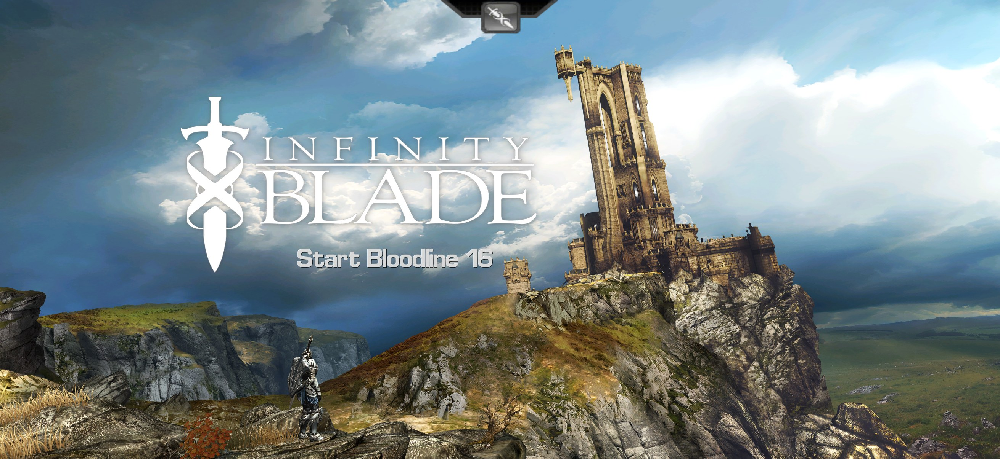

---

## Releases

| Version | Date | Highlights |
|---|---|---|
| **[1.3](https://github.com/finbuildssystems/IB1-Remaster/releases/tag/v1.3)** | 30 Oct 2026 | Feel every blow: haptics on iPhone, smooth skipping through dialogue, a Turn Off Tutorials option, and the way back to the gate fixed |
| **[1.2](https://github.com/finbuildssystems/IB1-Remaster/releases/tag/v1.2)** | 26 Oct 2026 | The biggest update yet: lost 2010 content switched on, HD lighting across the castle, play your own music, and the game on iPad |
| **[1.1](https://github.com/finbuildssystems/IB1-Remaster/releases/tag/v1.1)** | 25 Oct 2026 | Hide The HUD and Hide Combat Text options, every effect in HD, and spells that read your drawing correctly |
| **[1.0](https://github.com/finbuildssystems/IB1-Remaster/releases/tag/v1.0)** | 25 Oct 2026 | First release: sound restored, full screen at native resolution, HD textures, PC-style graphics and 20+ bug fixes |

---

## Screenshots

All taken on an iPhone 17 at its native resolution (2622 × 1206), most with **Hide The HUD** switched on.

<table>
<tr>
<td width="50%">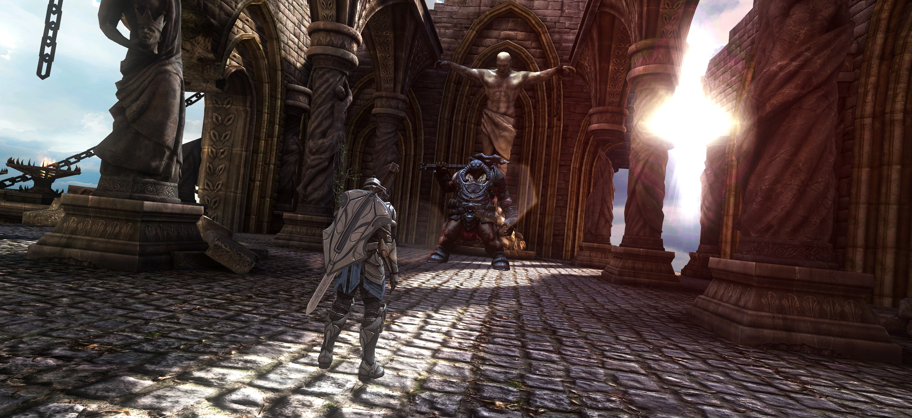 Sunlight and lens flare in the courtyard</td>
<td width="50%">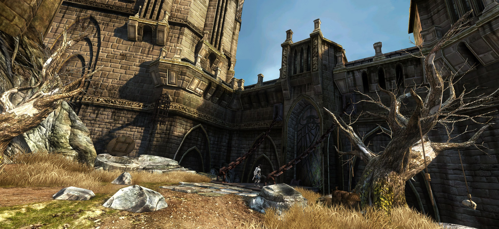 The castle gate, with HD lighting</td>
</tr>
<tr>
<td>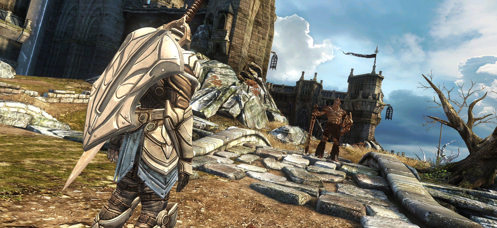 Facing the Faun</td>
<td>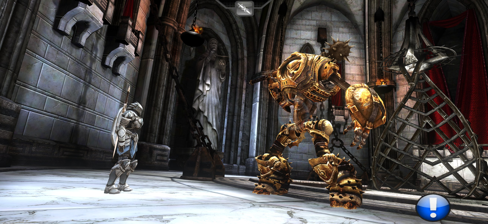 A golden golem, with the HUD on</td>
</tr>
<tr>
<td>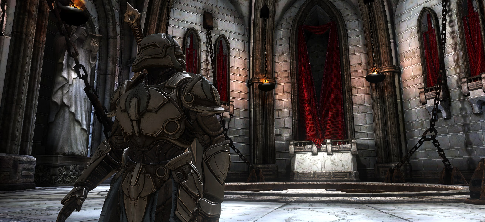 Your own gear, rebuilt in HD</td>
<td>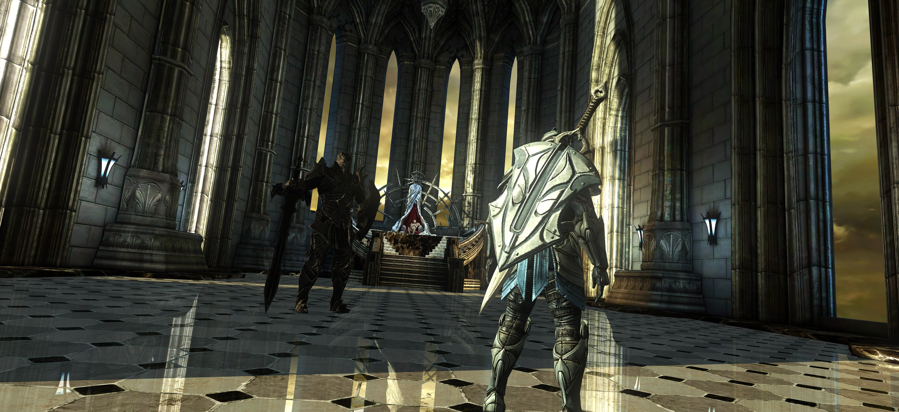 The God King's throne room</td>
</tr>
<tr>
<td>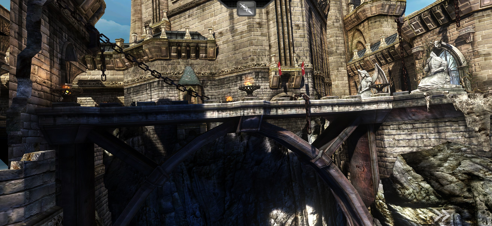 The bridge, home of the restored secret</td>
<td>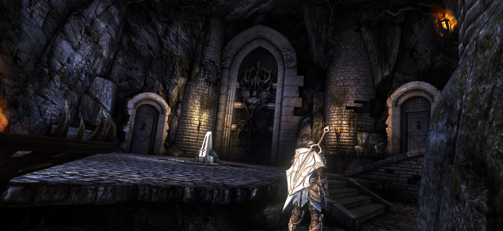 The dungeon, lit by torchlight</td>
</tr>
</table>

### On iPad

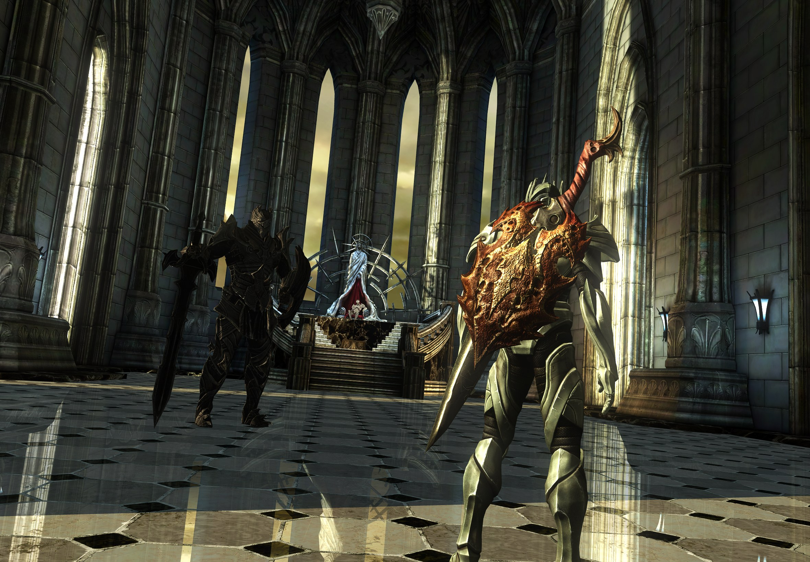 
The throne room on iPad, full screen at 60 fps

### New options

<table>
<tr>
<td width="33%">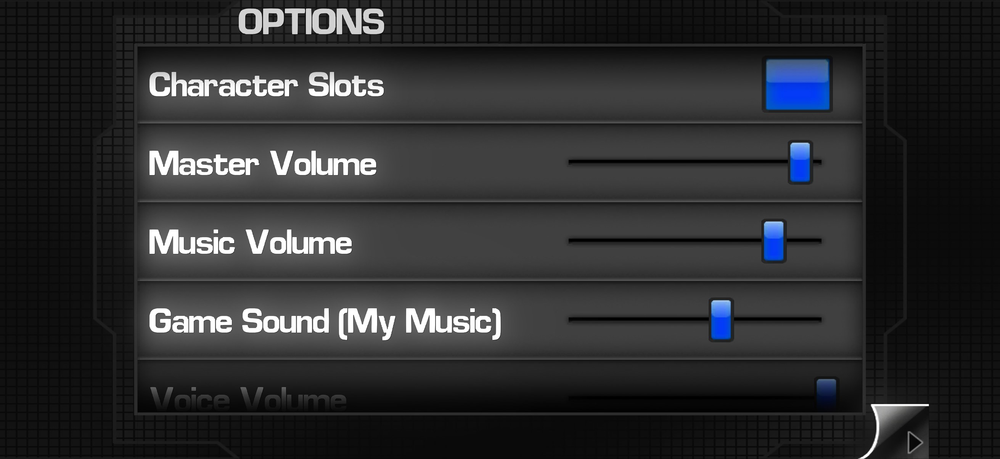 Sound, including Game Sound (My Music)</td>
<td width="33%">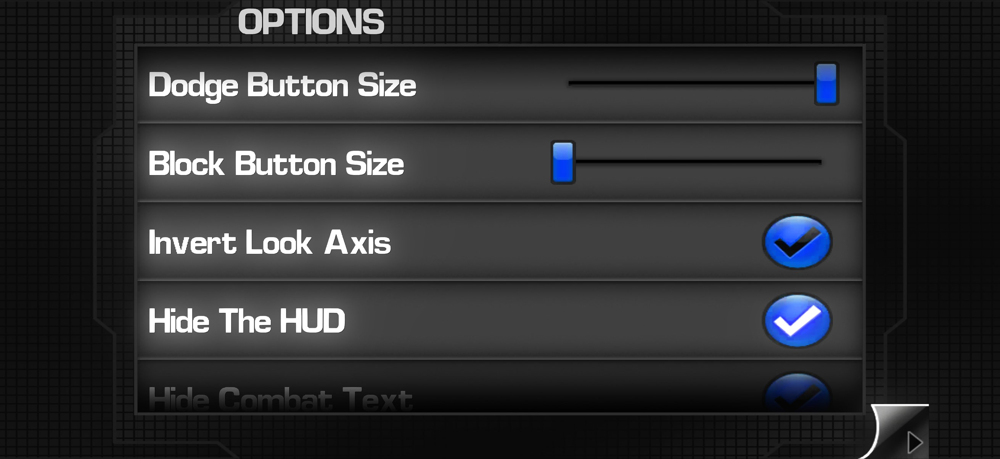 Block Button Size and Hide The HUD</td>
<td width="33%">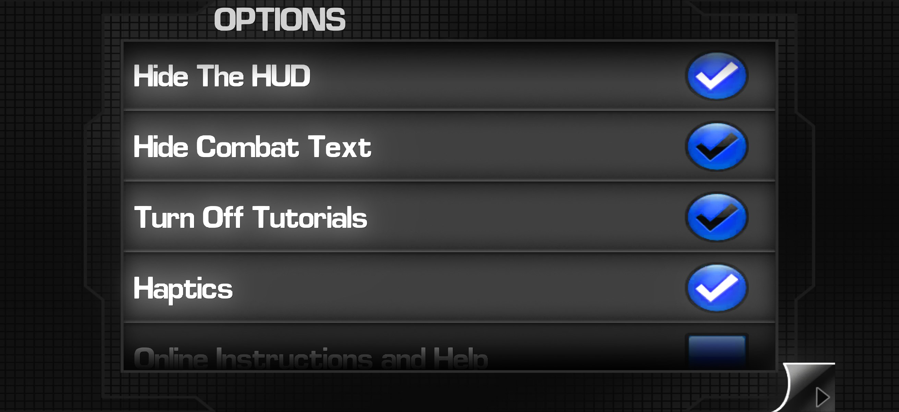 Hide Combat Text, Turn Off Tutorials and Haptics</td>
</tr>
</table>

---

## About

Infinity Blade set the standard for what a phone game could look like when it came out in December 2010. Fifteen years later, the original no longer works on a current iPhone. There are no sword sounds or voices, the picture doesn't fill the screen, and half the controls sit off the edge.

IB1 Remaster starts from the original game (version 1.4.3 with the fan Community Patch 2.5) and leaves its data files untouched. Every change is made by a small add-on that loads with the game. The result is the game as Chair Entertainment made it, running in full on a modern iPhone and iPad, sharper than it has ever looked, without bugs that had been there since 2010, and with content the developers finished but never switched on.

| | |
|---|---|
| **Latest release** | [1.3](https://github.com/finbuildssystems/IB1-Remaster/releases/latest) (30 October 2026) |
| **Runs on** | iPhone and iPad, full screen |
| **Tested on** | iPhone 17 (iOS 27.0.1) and iPad Air |
| **Base game** | Infinity Blade 1.4.3 + Community Patch 2.5 (data files unchanged) |
| **Frame rate** | 60 fps |
| **Download size** | About 2 GB |
| **App size** | About 3.1 GB installed |

---

## Install

Download the IPA from the [latest release](https://github.com/finbuildssystems/IB1-Remaster/releases/latest) and sideload it with **Impactor**, the tool recommended on the Infinity Blade Discord. The same file works on iPhone and iPad.

---

## What's new

### Lost content, found
Chair finished all of this and never switched it on. It's in the game now, exactly where they meant it to be.
- **Five new lessons.** *Mega Hit* and *Ultra Hit* teach the four- and five-swipe combos the game never explained. *Stab* shows you how to strike an enemy's weak spots. *Info2* gives you a labelled tour of the fight screen. *Menu* tells you when you have enough gold (400) to go shopping. Each one appears in your first bloodline, at the moment the developers' own notes said it should.
- **A secret at the bridge.** Stand on the bridge and look up. High on the great tower, a glowing circle is waiting. Tap it for a cinematic shot rising slowly up the tower to the God King's window, where he's watching you. It appears once per bloodline, so keep your eyes open.
- **The first Deathless King gets his moment.** Fall to the Faun and you'll now see his finishing blow land, your knight go down and the screen fade to black before the next bloodline begins, as the developers wired it.
- **A way back from the dungeon.** A "Back to Gate" circle at the dungeon's first save points takes you straight back to the castle gate.
- **COPY on Character Slots.** Copy your current character into any other slot (the game asks first), so you can try something risky and keep a safe copy.

### Looks
- **Full screen at full sharpness.** Drawn at the device's native resolution, edge to edge, with no letterboxing or stretching, on iPhone and iPad.
- **HD lighting across the whole castle.** The original stored light and shadow at 2 bits per pixel, which left green and purple blotches on the stone, speckled edges and smeared outlines. All 161 light maps are cleaned up, keeping the original's mood, with the PC version's finer detail added wherever it matches.
- **HD textures for the whole game.** About 680 textures replaced with clean versions up to 4096 × 4096. These come from the fan-made HD texture pack where it covers them, and from the PC version's originals elsewhere. Each one is colour-matched to the iPhone original so the look stays the same.
- **HD effects.** Fire, lightning, smoke, glows, the sword slash and the God King's sky are all in HD. Many are rebuilt from the original PC artwork.
- **Your own gear in HD.** The game builds the knight's swords, shields, armour and helmets into one combined texture while it runs. That texture is now rebuilt from HD pieces.
- **HD item icons.** All 115 shop and inventory icons enlarged 4×. The 54 weapon icons were redrawn from each weapon's own 3D model and coloured to match the originals.
- **HD menu lettering** in every language the game supports.
- **PC-style graphics settings.** Full-size textures everywhere (statues and columns had been drawn at a quarter of their detail), smooth texture blending, 4× anti-aliasing and 16× anisotropic filtering, none of which the game had switched on.
- **Light effects.** Soft bloom on bright areas, a gentle film-style contrast curve and sharpening. These apply to the 3D scene only, never to the menus.
- **Bump and shine maps from the PC version**, 76 of them across the castle, so stone, metal and floors catch the light.
- **PC-style lens flare.** The sun's flare now fades when your knight, a wall or a chest blocks it, instead of shining straight through.
- **The original 2010 opening film is back** in HD. It's widened to fill the screen, its lighting is extended into the new side areas, and its judder is smoothed out.
- **A sensible field of view.** On today's long screens the original widened the view so far you could see where levels end. It's now set to match the 16:9 phones the developers designed for.
- **A steady 60 fps** with all of the above, thanks to the Community Patch.

### Sound and music
- **Sword sounds, voices and effects are back.** On iOS 26 and later, the original plays only music.
- **Play your own music.** The developers added this in 2011, and it works properly again. Start your music, open the game and it keeps playing, with the game's sound effects mixed in underneath. Pause or play from Control Centre, the lock screen or your headphones, and the game switches over instantly: its own music steps aside when yours starts and comes back when yours stops.
- **New volume sliders** for Master, Music and Voice, alongside the original SFX slider, plus **Game Sound (My Music)**, which sets how loud the clashes and voices are while your own music plays.
- **Speech you can hear.** Music dips while characters speak, and their lines are slightly louder. The God King's offer was nearly drowned out before.
- **Fight music follows the fight.** Stage changes play the right track, and the tracks stay in step.
- **Music when you resume a saved game**, and "fade out" moments are silent, as intended.
- **No dropped sounds in busy moments.** The sound engine now has 64 voices instead of 32.

### Haptics
- **Feel the fight in your hand.** A good block, every hit you take (including a mistimed dodge) and a shield bash land with a solid thump.
- **The big moments shake the phone.** The giant bosses' slams, stomps and ground-shaking blows, and the Golems' blasts, come through as a deep, rolling rumble.
- **Finish a boss and feel it twice:** once as your sword goes in, and again as he hits the ground.
- **The God King hits hardest of all.** You feel his body slam when he makes his offer, the blow that throws you across the room in his last stage, and the crash as he lands.
- **Only the big moments.** Your own swings, parries, dodges, misses and spells stay quiet.
- **On by default.** Untick **Haptics** in Options to turn it off. iPhone only, since the iPad has no vibration motor.

### Now on iPad
- **Full screen on iPad**, the same game as on iPhone, at the iPad's full sharpness and 60 frames per second.
- **The opening film and Start button are back.** The original mistook modern iPads for the 2010 model and skipped both.
- **Everything else carries over:** the same HD graphics and effects, subtitles at the same size, and health numbers sized to sit comfortably at the iPad's edges.

### Controls and screen
- **Hide The HUD.** A clean screen during play. Your buttons still work while it's hidden.
- **Hide Combat Text.** Removes the pop-up words and damage numbers. Both options are in Options, under Invert Look Axis.
- **Turn Off Tutorials.** Chair built this switch and never put it in the menu. Tick it in Options and the lesson pages stop appearing, including the ones in the first bloodline's fights. It's saved with each character.
- **Smooth skipping through dialogue.** Hold skip while someone is talking and their line stops cleanly, with other sounds turned down while you hold. Let go, and the scene carries on from the right word, with only that line's subtitle on screen.
- **Redesigned dodge buttons.** The dark square panel is gone. The arrows are now deep black with a soft white glow, matching the health bar, and they light up in the game's blue when pressed. They're drawn at their true shape and at twice the detail.
- **Block button size slider**, under the game's own Dodge Button Size setting. It goes from the original size up to 1.5×, and the shield, its number and its touch area all grow together.
- **Controls and health bars clear of the Dynamic Island** and the rounded corners.
- **Accurate taps on glowing circles.** Every glowing circle takes your tap exactly where it's drawn, at save points and in fights.
- **Fast-forward only while held.** It can no longer get stuck and race through later cutscenes.
- **The skip button works wherever you tap it**, including its bottom half at the screen's edge.
- **Swiping home no longer swings the camera.**
- **Larger subtitles**, a hidden status bar and home bar, and a properly placed Start button.

### Menus and convenience
- **Every menu and screen fills the display**, with no black or bright strips at the sides.
- **Saves appear in the Files app** (On My iPhone → Infinity Blade), so you can back them up without a computer.
- **The broken gold store is switched off.** It used to hang forever on "Connecting to iTunes". The shop now behaves as designed for builds without a store: BUY only lights up when you can afford something, and spending gold you don't have tells you how much more you need.
- **No more "NEW! CONTENT PACK" pop-ups** one after another when you start the game on a new device.
- **The end screen shows its Infinity Blade logo again.**

---

## Bugs fixed

### From the original 2010 game
These were in the game as released, not caused by modern iPhones.
- Cutscenes losing their sounds and effects in long sessions: footsteps, shouts, screams and the God King's blue flames vanished the longer you played, until a restart.
- Spells misreading your drawing: a heal drawn with sharp corners cast poison, and four other rings had the same problem.
- The Faun cutting himself off mid-word. His intro plays sped up, and each line used to start before the last one finished.
- Fight music jumping back to the first stage's track when a fight moved on quickly, so the second stage's music was never heard.
- No stage music changes in the Guardian fight, which opens every bloodline.
- Silence after resuming a save. Only 3 of the castle's 37 save points restarted the music.
- "Fade out" moments playing the castle walking music instead of silence.
- Zero's death music never playing, because the file was requested with the wrong capital letter.
- The knight walking past his spot to the cliff edge in the opening scene, when two of the developers' films competed to control him.
- Fast-forward sticking on and racing through later cutscenes by itself.
- A dazed boss knocked below its next-stage mark staying in the old stage until another hit landed. It now changes stage as soon as the daze ends.
- The God King's dying lines playing over a black screen after skipping his ending.
- The end screen's missing logo.
- The sun's flare shining through characters and walls (the iPhone version never had the PC version's check).
- Judder in the opening film, where every fifth frame of movement was doubled by the original 2010 conversion.
- The Infinity Blade not fitting the dais in the dungeon: it stuck out of the top and bottom of its slot, and went into the floor as the panel lowered. This was still in the game at Epic's last update.

### From running a 2010 game on a modern iPhone and iPad
- No sound effects or voices, only music (iOS 26 and later).
- No music on first launch.
- Your own music stopping when the game starts or when you come back to it.
- A letterboxed picture instead of full screen.
- No opening film or Start button on modern iPads, which the original mistook for the 2010 model.
- Health bars and the block, dodge and fast-forward buttons off-screen once the picture filled the display.
- Bright strips and black sides on the results screen, tutorials, Options and Character Slots.
- Touch circles drawn beside enemies instead of on them.
- Sound cutting out after a half swipe up, Control Centre or a call banner, and effects going permanently silent after a pause.
- The picture rendered below the screen's native sharpness.
- The skip button only responding when tapped above its middle.

### Other fixes
- Voices piling on top of each other when skipping through dialogue, and lines restarting from the beginning after the scene had moved on.
- Going back to the gate bringing back a chest you'd already opened. Tapping its circle again froze the game.
- Going back down the well after beating the boss in the cell leaving you stuck with no enemy and no circles. The scene after his fight now plays, and the next fight at the door is ready, as Chair intended.
- The knight flashing dark blue for a moment after a scene moved him somewhere new. He's now lit for where he stands.
- The knight facing the wrong way for a moment when you tap Start.
- A safety net borrowed from Infinity Blade II, which runs on the same engine: if a waiting boss ever freezes like a statue during his idle animation, he keeps moving.

---

## How the big ones were found

<b>1. Cutscenes going quiet, and the God King's missing flames (a 2010 bug)</b>

**Found:** In long sessions, walk-ups to enemies were silent, enemies drew their swords without a shout, and kicked enemies didn't scream. The God King's blue flames disappeared in his intro and at the final stab, but never in the two scenes in between.

**Tracked down:** Logs showed that the cutscenes' cues (the sound and effect markers inside each animation) weren't firing at all. A test build recorded each God King cue as it came due. The film requested it every time, but his animation was set to fire cues only at full blend, and at those moments it was a hair short of full. That setting came from the game's own fight code, which switches it on when a move ends so the move's sounds don't play as it fades out. Cutscenes reuse the same animation slot and never switch it back. A fresh start has no such slots, which is why restarting the game brought the effects back. I remember exactly that from playing on my iPhone 5.

**Fixed:** Whenever a cutscene takes over an animation slot, it switches back to "always fire cues", just as the game does when a fight move starts. One fix covers every cutscene in the game.

<b>2. A silent game on iOS 26</b>

**Found:** Music played, but there were no swords, grunts or voices.

**Tracked down:** The game pauses its sound engine with a counter whenever iOS interrupts the audio. The opening film triggers an interruption, and current iOS never sends the "interruption ended" message, so the counter stays stuck.

**Fixed:** Once a second, if the sound engine is paused when nothing should be pausing it, the game's own "interruption ended" code is called.

<b>3. The mech's intro racing past in a blur</b>

**Found:** Starting the mech fight jumped straight to the middle of the battle.

**Tracked down:** Fast-forward was switching back on with no finger on the button. Over five test runs it turned out the game keeps three saved copies of its speed: one for the fast-forward button, one for the pause menu, and one in every film with a slow-motion section. A copy saved while you held fast-forward would switch fast-forward back on later. Every saved log was then replayed to count each case by its cause.

**Fixed:** None of the three copies can hold a fast-forward speed, and a fast-forward with no finger down is ended immediately.

<b>4. "My own armour doesn't look HD"</b>

**Found:** Enemies looked HD, but the knight's equipped shield and armour didn't.

**Tracked down:** The game never uses an item's texture directly. While it runs, it builds one combined texture from everything you're wearing, so the HD swap never saw the individual item textures.

**Fixed:** The combined texture is now recognised piece by piece and rebuilt from the HD versions. Every texture the game loads is checked, so a miss would show up immediately.

<b>5. Fight music going backwards</b>

**Found:** The second stage's music never seemed to play.

**Tracked down:** The developers set each intro track to start the next track when it finished, however it finished. When a stage change replaced the intro early, that link still fired and put the first stage's track back on.

**Fixed:** That handover is skipped when another track has already taken over, in all 25 places the developers used it.

<b>6. Zero's death music</b>

**Found:** His death scene was silent.

**Tracked down:** It requests "menu-normal", but the file is "Menu-Normal.mp3", and iOS treats capital letters as different.

**Fixed:** Every music request now finds its file regardless of capitalisation.

<b>7. The Infinity Blade that didn't fit</b>

**Found:** When the knight sets the Infinity Blade into the pillar in the dungeon, it stuck out of the top and bottom of its slot, and its tip went into the floor as the panel lowered. The bug was still there in Epic's last update.

**Tracked down:** Chair made the slot in the pillar's front panel exactly the blade's length, then placed that panel in the level at three-quarters size. The knight's animation was made for the smaller panel, but the blade is full size. So the blade overhung the slot by about 15 cm at each end, and once the panel lowered, its tip went 11 cm into the floor.

**Fixed:** While the knight sets the blade in the pillar, the blade is drawn at three-quarters of its size, giving the same snug fit as Chair's full-size slot and blade. The camera cuts at the exact moments that animation starts and stops, so you never see the blade change size. Nothing else in the game is affected, and the blade is back to full size as soon as the scene moves on.

---

## Under the hood

| Area | Detail |
|---|---|
| Base game | Infinity Blade 1.4.3 + Community Patch 2.5 (data files unchanged) |
| Devices | iPhone 17 (iOS 27.0.1) and iPad Air |
| Resolution | The device's native resolution (2622 × 1206 on iPhone 17), 60 fps |
| Textures | About 680 in HD, up to 4096 × 4096, plus HD effects |
| Lighting | All 161 light maps rebuilt in HD |
| Graphics | 4× anti-aliasing, 16× anisotropic filtering, full-size mip levels, bloom, contrast curve, sharpening, bump and shine maps |
| Sound | 64 mixer voices (was 32); Master, Music, SFX, Voice and Game Sound (My Music) sliders; plays alongside your own music |
| Haptics | Blocks, hits, boss slams and the God King's blows (iPhone); can be switched off in Options |
| App size | About 3.1 GB |

---

## Build history

Every test build, and which ones became releases.

<b>Show all builds</b>

| Build | Date | What came in |
|---|---|---|
| 1 | 21 Oct 2026 | The game working on the iPhone 17: sound and voices, full screen, controls, menus, music fixes, volume sliders, no stuck gold store, field of view |
| 2 | 21 Oct | Full sharpness; saves in the Files app |
| 3 | 21 Oct | The original opening film, in HD |
| 4 | 21 Oct | The opening film fills the screen; the knight stops on his rock |
| 5 | 22 Oct | The skip button responds at the bottom edge |
| 6 | 22 Oct | New dodge buttons |
| 7 | 22 Oct | Block button size setting |
| 8 | 22 Oct | No more dropped sounds in busy moments |
| 9 | 22 Oct | Graphics settings and light effects |
| 10 | 22 Oct | Effects on every frame; fight music that keeps up |
| 11 | 22 Oct | Swiping home no longer moves the camera |
| 12 | 24 Oct | Bump and shine maps, PC textures, the sun's flare, stage music |
| 13 | 24 Oct | The end screen's logo, sound safety checks |
| 14 | 24 Oct | Speech over music, Voice Volume slider, skipped ending stays skipped |
| 15 | 24 Oct | An experimental effects "safety net" switched off |
| 16 | 24 Oct | HD textures for the whole game, HD gear, HD icons |
| **17** | **24 Oct** | **Fast-forward only while held — released as 1.0** |
| 18 | 25 Oct | Every cutscene keeps its sounds and effects, however long you play |
| **19** | **25 Oct** | **Hide The HUD and Hide Combat Text options, HD effects, spells read your drawing correctly — released as 1.1** |
| **20** | **26 Oct** | **Lost content restored, HD lighting, play your own music, iPad support, accurate circle taps, the Faun's intro, no content-pack pop-ups — released as 1.2** |
| **21** | **30 Oct** | **Haptics, smooth skipping through dialogue, Turn Off Tutorials option, back-to-gate and well fixes, the Infinity Blade fits the dais — released as 1.3** |

---

## Credits
Infinity Blade by **Chair Entertainment** and **Epic Games**. Built on the fan **Community Patch 2.5** and the fan-made **HD texture pack**, plus the PC version's original textures. Restoration work by Second Light.

*This is a personal, non-commercial restoration project. Infinity Blade and all its assets belong to their respective owners.*
